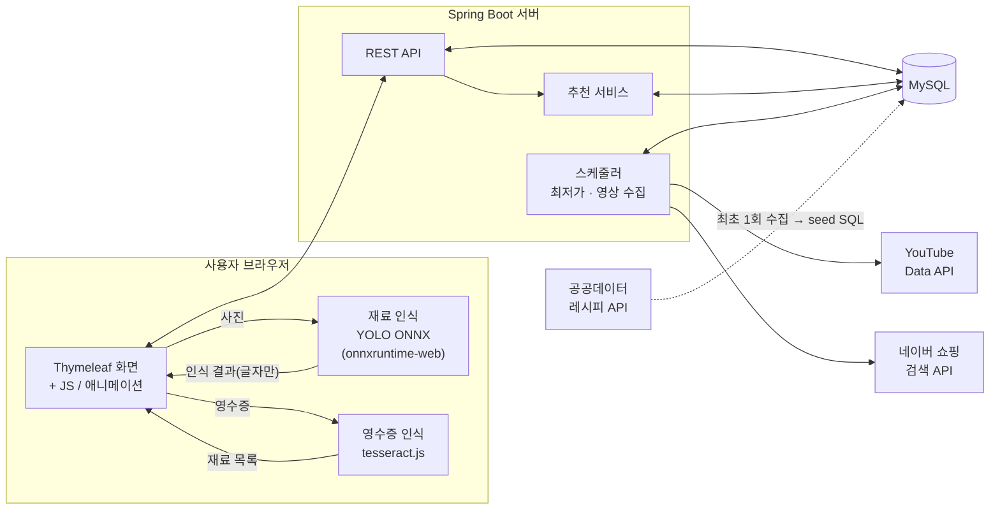
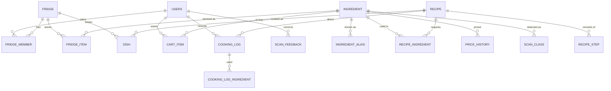

# 🧊 냉장고를 부탁해 (요리조리)

> 냉장고 속 재료를 사진 한 장으로 등록하면, 소비기한이 임박한 재료부터 쓰는 레시피를 추천해 음식물 쓰레기를 줄여 주는 웹 서비스

경성대학교 팀 프로젝트 (3명) · 2026년 2학기

| 역할 | 담당 |
|------|------|
| 팀장 · 백엔드 | 회원·인증, DB·JPA, REST API, 스케줄러, AWS 배포 |
| 백엔드 · 프론트엔드 · AI | 재료 인식 모델, 영수증 인식, 레시피 데이터, 추천 로직, 프론트–AI 연동 |
| 프론트엔드 · 디자인 | Figma 화면 설계, Thymeleaf 템플릿, CSS, 애니메이션 |

---

## 목차

1. [배경과 목적](#1-배경과-목적)
2. [기능과 구현 현황](#2-기능과-구현-현황)
3. [화면 구성](#3-화면-구성)
4. [기술 스택](#4-기술-스택)
5. [시스템 구조](#5-시스템-구조)
6. [폴더 구조와 파트 분담](#6-폴더-구조와-파트-분담)
7. [AI 파트](#7-ai-파트)
8. [레시피 추천 방식](#8-레시피-추천-방식)
9. [데이터베이스 설계](#9-데이터베이스-설계)
10. [API 명세](#10-api-명세)
11. [외부 서비스와 제약](#11-외부-서비스와-제약)
12. [실행 방법](#12-실행-방법)
13. [일정과 로드맵](#13-일정과-로드맵)
14. [협업 규칙](#14-협업-규칙)
15. [데모 버전 기록](#15-데모-버전-기록)
16. [라이선스와 데이터 출처](#16-라이선스와-데이터-출처)

---

## 1. 배경과 목적

- 냉장고에 재료가 있어도 **무엇을 만들 수 있는지** 떠올리기 어려움
- 채소·과일·정육 같은 신선 재료는 **소비기한 표시가 없어** 언제까지 먹을 수 있는지 모름
- 요리하고 나면 냉장고 정보를 직접 고쳐야 해서 **실제 상태와 쉽게 달라짐**

**목적** : 재료와 소비기한을 자동으로 관리하고, 임박한 재료를 먼저 쓰는 요리를 추천해 음식물 폐기 줄이기

---

## 2. 기능과 구현 현황

상태 표시

- ✅ **데모 완료** : HTML 데모에서 동작. 데이터는 브라우저 저장소(localStorage)에 저장
- 🔧 **서버 연동 필요** : 화면은 있지만 서버나 외부 API가 있어야 실제로 동작
- 📅 **예정** : 예정인 기능이거나, 추가했으면 싶은 것
- ❌ **불가** : 외부 제약으로 만들 수 없음, 대체 방법 사용

### 2-1. 식재료 관리

| 기능 | 상태 | 설명 |
|---|---|---|
| 식재료 직접 입력 | ✅ | 재료 기준표 70종 자동완성, 단위·기본 수량 자동 지정 |
| 초성 검색 | ✅ | `ㅇㅍ` → 양파, `ㄱㅊㅉㄱ` → 김치찌개. 재료 입력, 레시피, 식재료 검색에 모두 적용 |
| 소비기한 자동 안내 | ✅ | 등록일 + 재료별 냉장 보관 일수. "참고용" 표시 |
| 소비기한·수량 수정 | ✅ | 재료를 누르면 수정 창 열림 (±일 버튼, 자동 안내 날짜로 되돌리기) |
| 임박 재료 표시 | ✅ | D-day 배지, 3일 이내 강조, 기한 현황 통계 |
| 사진 스캔으로 등록 | ✅ | 브라우저 안에서 YOLO 모델(v4)로 33종 인식 → 확인·수정 후 등록 ([7-1](#7-1-재료-사진-인식)) |
| 여러 장 이어서 스캔 | ✅ | 냉장고 칸마다 찍어도 한 목록에 모임. 같은 재료는 수량을 합치고 사진별 개수 표시 (v9) |
| 재료별 인식 기준 | ✅ | 잘 맞히는 재료는 50%, 약한 재료는 70% 이상이어야 자동 체크. 헷갈리는 재료는 "혹시 ○○?" 버튼 (v9) |
| 스캔 결과에서 직접 추가 | ✅ | 빠진 재료 직접 추가, 자주 놓치는 재료 버튼, 신뢰도 낮은 결과는 "후보"로 표시 |
| 영수증 사진으로 등록 | ✅ | 브라우저 안에서 한글 글자 인식 → 상품명을 재료로 변환 ([7-2](#7-2-영수증주문내역-인식)) |
| 쇼핑몰 주문내역으로 등록 | ✅ | 쿠팡·컬리·네이버 주문내역을 캡처하거나 글자를 복사해 붙여넣기 |
| 주문내역 자동 가져오기 | ❌ | 쇼핑몰에 공개 API가 없어 불가능하니 캡처 및 붙여넣기로 대체 |
| 회원별 냉장고 저장 | 🔧 | 서버 API·DB 완료(`/api/fridge/items`). 화면은 아직 브라우저에 저장, API 연결 진행 중 |
| 가족 공유 냉장고 | 📅 | `fridge` / `fridge_member` 구조로 미리 설계 |

### 2-2. 레시피 추천

| 기능 | 상태 | 설명 |
|---|---|---|
| 공공데이터 레시피 | ✅ | 537건 + 데모 레시피 = 560건 (Flyway seed `V3__seed_recipe.sql`) |
| 임박 재료 우선 추천 | ✅ | 보유율 + 임박 가산점 ([8](#8-레시피-추천-방식)) |
| 바로 만들 수 있는 순 정렬 | ✅ | 부족한 재료 수가 적은 순서 |
| 부족한 재료 안내 | ✅ | 재료별로 보유 / 조금 부족 / 부족 / 선택 표시 |
| 레시피 상세 | ✅ | 요약, 재료 분량 원문, 조리 순서, 기본 양념, 출처 |
| 최근 만든 요리 순위 조정 | ✅ | 2일 안에 만든 요리는 순위를 낮추고 "○일 전 만듦" 표시 |
| 못 먹는 재료 (알레르기·기피) | ✅ | 알레르기 16묶음 + 직접 추가. 추천에서 빼거나 빨갛게 표시, 기본 양념까지 확인 (v9) |
| 레시피 영상 | ✅ / 🔧 | 유튜브·만개의레시피 검색 연결 완료. 영상 ID 수집기(`YoutubeVideoCollector`) 완료, API 키 등록 후 동작 |

### 2-3. 요리 완료와 만든 요리

| 기능 | 상태 | 설명 |
|---|---|---|
| 사용 재료 자동 차감 | ✅ | 차감 전에 사용량을 확인·수정, 소비기한이 가까운 재료부터 제외 |
| 만든 요리 보관함 | ✅ | 인분 단위로 보관하고, 요리 분류별 보관 기한(밥 1일, 찌개 3일, 조림 4일 등)을 안내 |
| 먹기 / 버리기 | ✅ | 1인분씩 먹기, 남은 양 버리기 |
| 요리 기록·통계 | ✅ | 이번 달 만든 요리, 먹은 인분, 살린 임박 재료, 버린 것. 기록에서 "다시 만들기" |

### 2-4. 장보기

| 기능 | 상태 | 설명 |
|---|---|---|
| 장보기 목록 | ✅ | 직접 담기, 레시피의 부족한 재료를 한 번에 담기 |
| 쇼핑몰 연결 | ✅ | 쿠팡·네이버쇼핑 낮은 가격순 검색, 마켓컬리 검색 |
| 산 재료를 냉장고로 | ✅ | "샀어요" 버튼. 스캔이나 영수증으로 등록하면 목록에서 자동 삭제 |
| 목표가 설정 | ✅ | 값은 저장되지만 알림은 아직 미동작 |
| 최저가 알림 | 🔧 | 네이버 쇼핑 검색 API + 스케줄러 코드 완료(`PriceCheckScheduler`). API 키 등록·알림 방식(웹 푸시/메일) 남음 |
| 쿠팡 가격 직접 조회 | 📅 | 쿠팡 파트너스 최종 승인 후 ([11](#11-외부-서비스와-제약)) |

### 2-5. 화면·사용성

| 기능 | 상태 | 설명 |
|---|---|---|
| PC / 모바일 화면 전환 | ✅ | 버튼 하나로 전환. 모바일 프레임 크기 조절, 컨테이너 기준 반응형 |
| 애니메이션 | ✅ | 요리(재료 → 끓이기 → 완성 → 보관함), 먹기, 버리기(쓰레기통). 2~3초, 누르면 건너뛰기 |
| 애니메이션 On/Off | ✅ | 설정 유지. 기기의 "동작 줄이기" 설정을 따름 |
| 다크 모드 | ✅ | 시스템 설정을 따름 |
| 회원가입·로그인 | ✅ / 🔧 | Spring Security 세션 로그인 완료 (`/api/auth`). 로그인 후 데이터 서버 저장은 연결 진행 중 |
| 레시피 커뮤니티 | 📅 | 만든 요리에 사진과 후기를 붙여 공유 혹은 자신이 개발한 레시피 공유 등 |
| 나만의 레시피 | 📅 | 내가 만든 레시피를 등록하기 |

---

## 3. 화면 구성

| 화면 | 주요 내용 |
|---|---|
| 홈 | 서비스 소개, 빠른 재료 입력 |
| My 냉장고 | 재료 입력(직접·사진·영수증), 분류별 선반, 만든 요리 줄, 소비기한 현황 |
| AI 매칭 레시피 | 추천 목록, 정렬, 검색(초성), 더 보기, 못 먹는 재료 설정 |
| 레시피 상세 | 재료·보유 여부, 조리 순서, 영상, 부족한 재료 장보기 담기, 요리 완료 |
| 만든 요리 | 보관 중인 요리(먹기·버리기), 이번 달 기록, 최근 기록 |
| 내 식재료 | 표 형태 관리, 수량·소비기한 바로 수정, 검색 |
| 장보기 | 장보기 목록, 쇼핑몰 연결, 목표가, 최저가 안내 |
| 스캔 창 | 재료 사진(여러 장) ↔ 영수증·주문내역 전환, 결과 확인·수정 후 등록 |

모바일 하단 탭: **냉장고 · 레시피 · [스캔] · 만든 요리 · 장보기**

---

## 4. 기술 스택

| 구분 | 기술 |
|---|---|
| 백엔드 | Java 17, Spring Boot 3, Spring Data JPA, Spring Security, Spring Scheduler |
| 프론트엔드 | Thymeleaf, HTML/CSS/JavaScript, Web Animations API |
| 데이터베이스 | MySQL 8 (로컬 개발은 H2 MySQL 모드), Flyway |
| AI · 재료 인식 | Ultralytics YOLO26n → ONNX, onnxruntime-web (WebGPU / WASM) |
| AI · 글자 인식 | tesseract.js (한국어 + 영어) |
| 학습 환경 | Roboflow(데이터셋), Google Colab T4 GPU |
| 외부 데이터 | 농림축산식품 공공데이터 레시피 API, YouTube Data API, 네이버 쇼핑 검색 API |
| 배포 | AWS (EC2 + RDS 검토) |
| 디자인 | Figma, 고운 돋움 글꼴 |

---

## 5. 시스템 구조



**핵심 설계** : 사진과 영수증은 **브라우저 안에서만 분석**, 서버로 보내지 않음

- AI API 비용 0원, 사용 횟수 제한 없음
- 개인 사진이 밖으로 나가지 않음
- 서버 부하 없음

---

## 6. 폴더 구조와 파트 분담

```
yorijori/
├─ backend/                                Spring Boot 3.5 · Java 17 (백엔드 + 프론트엔드)
│  ├─ build.gradle · gradlew               ./gradlew bootRun
│  └─ src/main/
│     ├─ java/com/yorijori/
│     │  ├─ user/          회원가입·로그인·못 먹는 재료 설정        [백]
│     │  ├─ fridge/        냉장고·식재료·소비기한·차감             [백]
│     │  ├─ ingredient/    재료 기준표·동의어·알레르기 묶음·스캔 클래스·인식 수정 기록 [백·AI]
│     │  ├─ recipe/        레시피·추천 점수·영상 수집(video/)        [백·AI]
│     │  ├─ dish/          요리 완료·만든 요리·요리 기록·통계        [백]
│     │  ├─ cart/          장보기·최저가 스케줄러(price/)            [백]
│     │  └─ common/        설정·보안·예외·공통 응답·초성·화면 주소   [백]
│     └─ resources/
│        ├─ templates/     index.html + fragments/ + pages/ + auth/   [프론트]
│        ├─ static/css/    화면별 CSS 13개                            [프론트]
│        ├─ static/js/     화면 동작·애니메이션·초성 (데모 v9 코드를 나눈 것) [프론트]
│        ├─ static/js/ai/  fridge-scan.js(재료 인식) · receipt.js(영수증 규칙) [AI]
│        ├─ static/models/ fridge.onnx(v4) · classes.json             [AI]
│        └─ db/migration/  V1 스키마 · V2 재료·알레르기·스캔 클래스 · V3 레시피 560건 [백·AI]
├─ ai/
│  ├─ train/      Colab 노트북(v4), 데이터 병합·AI Hub 컷아웃·합성 스크립트, history/(v2·v3)
│  ├─ scan/       모델 테스트 페이지
│  ├─ receipt/    상품명 → 재료 규칙 사본 · 규칙 테스트(node)
│  └─ data/       공공 레시피 수집(RecipeFetch.java) · 정제(normalize.py) · seed SQL 생성(build_seed.py)
├─ demo/          단일 HTML 데모 v9 + build/(v3~v9 생성 스크립트, split_demo.py)
├─ docs/          api.md · erd/ · ai-model.md · 기획서/ · 회의록/
└─ .github/       협업 규칙(CONTRIBUTING.md) · PR·이슈 템플릿 · CI
```

폴더별 설명: [backend/README.md](backend/README.md) · [ai/README.md](ai/README.md) · [demo/README.md](demo/README.md)

### 파일별 담당

| 담당 | 주로 고치는 곳 |
|---|---|
| 백엔드 (팀장) | `backend/src/main/java/**` (user · fridge · dish · cart · common), `application*.yml`, `db/migration` 새 V 파일, AWS |
| 백엔드 · 프론트 · AI | `recipe/` 추천, `ingredient/` 스캔, `static/js/ai/`, `static/models/`, `static/js/scan*.js`, `ai/**`, 화면 ↔ API 연결(`api.js`) |
| 프론트 · 디자인 | `templates/**`, `static/css/**`, `static/js/` 화면·애니메이션(`render.js`, `anim.js`, `dish.js` …), Figma |

### 파트 통일 규칙 (데이터 내용 꼬이기 방지)

| 약속 | 관련 파트 | 내용 |
|---|---|---|
| API 명세 | 프론트 ↔ 백 | [10. API 명세](#10-api-명세). 바뀌면 `docs/api.md`부터 수정 |
| 모델 파일 규칙 | AI ↔ 프론트 | 입력 `[1,3,640,640]`, 출력 `[1,300,6]` (x1,y1,x2,y2,score,class), `classes.json` 형식. 이 규칙만 지키면 모델 파일만 바꿔 끼우면 끝 |
| 재료 이름 | 전체 | `ingredient` 테이블의 표준 이름만 사용. 다른 표기는 `ingredient_alias`에 추가 |

---

## 7. AI 파트

### 7-1. 재료 사진 인식

| 항목 | 내용 |
|---|---|
| 모델 | YOLO26n (Ultralytics 8.4), 현재 v4 (검증 mAP50 0.905) |
| 변환 | `export(format="onnx", imgsz=640, nms=False)` → 출력 `[1, 300, 6]` |
| 실행 | 브라우저에서 onnxruntime-web 1.30 (WebGPU 우선, 안 되면 WASM) |
| 속도 | 사진 1장 약 0.5초 (테스트 기준) |
| 신뢰도 처리 | 재료별 기준(50~70%) 이상 자동 체크, 미만은 "확인 필요", 15~35%는 "후보" (v9, [docs/ai-model.md](docs/ai-model.md)) |
| 인식 재료 (33종) | 양배추, 대파, 양파, 감자, 당근, 애호박, 오이, 무, 시금치, 버섯, 토마토, 고추, 마늘, 계란, 두부, 우유, 사과, 바나나, 레몬, 파프리카, 가지, 브로콜리, 옥수수, 치즈, 고구마, 배추, 배, 귤, 오렌지, 라임, 딸기, 포도, 키위 |

(인식 재료 추가에 대해서는 논의 필요, 인식 재료에 대한 추가 데이터 및 사진 라벨링 필요)

**학습 순서** (자세한 것은 [ai/README.md](ai/README.md))

1. Roboflow 공개 데이터셋 여러 개 + AI Hub 「농산물 품질(QC) 이미지」(국내에서만 받을 수 있어 PC에서 `qc_local.py`로 재료만 오려 냄) + 합성 사진 6,000장
2. 클래스 이름 통일, 중복 제거, 클래스당 박스 상한 → 33종 약 5.5만 장
3. Colab T4로 v3에서 이어 학습 (25 epoch, 약 7시간)
4. ONNX 변환 → `static/models/`에 넣기

**알려진 한계와 개선 계획**

- 오렌지·치즈·대파·고추·토마토 인식이 약함 (mAP50 0.70~0.83) → 기준을 70%로 올려 둠. 직접 찍은 사진으로 v5 학습
- 배추·배·귤은 합성 사진으로만 배워 검증 점수가 부풀려짐 → 실제 사진으로 확인 필요
- 두부는 검증 데이터가 8개뿐, 감·깻잎·콩나물은 아직 학습 전
- 사용자 수정 데이터 활용
  - **즉시** : 사용자별 수정 기록을 다음 인식에 반영 (예: 레몬 → 오렌지로 자주 고치면 오렌지를 먼저 표시)
  - **주기적으로** : `POST /api/scan/feedback`로 모은 수정 기록(`scan_feedback`) 중 동의한 것만 재학습에 사용

### 7-2. 영수증·주문내역 인식

1. tesseract.js(한국어 + 영어)로 **브라우저에서** 글자 읽기. 사진은 서버로 보내지 않음
2. 상품명을 재료로 변환. 긴 표기부터 먼저 찾고, 동의어 사전 72개 사용. 예: "한돈 삼겹살" → 돼지고기, "특란 30구" → 계란
3. 아래 줄은 제외
   - 상품이 아닌 줄: 배송비, 합계, 할인 등
   - 가공품: 양파링, 마늘가루, 주스 등
4. 수량 계산
   - `1.5kg 양파` → 약 8개 (1개당 무게 기준)
   - `30구` → 30개
   - `500g × 2팩` → 1000g
5. 사용자가 결과를 확인·수정한 뒤 등록. 글자 인식 원문도 함께 표시

### 7-3. 레시피 데이터

| 단계 | 내용 |
|---|---|
| 수집 | `RecipeFetch.java`로 기본·재료·과정 정보 3종 API 전부 수집 |
| 정제 | `normalize.py`로 재료명 표준화, 분량 파싱, 기본 양념 분리 |
| 결과 | 레시피 537건, 재료 5,824행, 조리 과정 2,870행 → `V3__seed_recipe.sql` |

---

## 8. 레시피 추천 방식

외부 생성형 AI 없이 **레시피 DB + 점수 규칙**으로 추천
(비용 및 추후 관리 필요성 때문)

```
점수 = 보유율 × 60 + 임박 가산점 − 최근 만듦 감점

보유율        = 가진 필수 재료 수 / 필수 재료 수
임박 가산점   = 이 레시피에 쓰이는 재료 중 가장 임박한 것이
               D-1 이하 +40 · D-3 이하 +25 · D-5 이하 +10
최근 만듦 감점 = 2일 안에 만든 레시피 −15
```

**이 방식을 고른 이유** (계획서 대비 변경 사항)

- 없는 재료나 엉뚱한 레시피를 지어내지 않음
- 응답 형식이 항상 같음
- API 비용과 호출 한도 없음

계획서 "6. 예상 이슈"의 세 가지(관계없는 레시피 추천, 응답 형식 불일치, API 비용 증가)를 함께 해결

---

## 9. 데이터베이스 설계

### 데이터 관리 원칙

| 종류 | 예시 | 누가 바꾸나 | 관리 방법 |
|---|---|---|---|
| 기준 데이터 | 재료, 레시피, 보관 기간 | 팀 | Flyway seed SQL (Git 관리) |
| 사용자 데이터 | 냉장고, 만든 요리, 장보기 | 사용자 | DB |
| 기록 데이터 | 요리·먹음·버림 기록, 가격 이력 | 시스템 | DB (통계·재학습용) |

- 재료는 **이름이 아니라 `ingredient_id`로 연결**. 기준표에 없는 재료는 이름만 저장할 수 있게 열어 둠
- 스키마 변경은 `V{번호}__설명.sql`로 추가, 이미 반영된 파일은 수정 금지

### 테이블 (예상이며, 추후 추가 및 수정 필요)

| 그룹 | 테이블 | 설명 |
|---|---|---|
| 기준 | `ingredient` | 재료 기준표 (분류, 냉장 보관 일수, 단위, 기본 수량) |
| 기준 | `ingredient_alias` | 동의어·상품명 표기 (달걀 → 계란, 한돈 삼겹 → 돼지고기) |
| 기준 | `recipe` | 레시피 (조리 시간, 난이도, 인분, 분류, 칼로리, 보관 일수, 영상 ID) |
| 기준 | `recipe_ingredient` | 레시피 재료 (주재료/부재료/양념, 선택 여부, 분량 원문) |
| 기준 | `recipe_step` | 조리 순서 |
| 기준 | `scan_class` | 모델 클래스 ↔ 재료, 모델 버전 |
| 기준 | `avoid_group`, `avoid_group_term` | 알레르기 묶음과 실제로 확인하는 이름 (대두 → 두부·콩·된장·간장…) (v9) |
| 사용자 | `users` | 회원 |
| 사용자 | `user_avoid` | 못 먹는 재료 (묶음 / 직접 입력) (v9) |
| 사용자 | `fridge`, `fridge_member` | 냉장고와 구성원 (가족 공유 대비) |
| 사용자 | `fridge_item` | 냉장고 재료 (수량, 등록일, 소비기한, 자동 안내 여부) |
| 사용자 | `dish` | 만든 요리 (만든 인분, 남은 인분, 보관 기한) |
| 사용자 | `cart_item` | 장보기 (목표가, 알림 여부) |
| 기록 | `cooking_log`, `cooking_log_ingredient` | 만듦·먹음·버림 기록, 사용 재료와 당시 남은 일수 |
| 기록 | `price_history` | 재료별·쇼핑몰별 가격 이력 |
| 기록 | `scan_feedback` | 인식 결과 수정 기록 (재학습 동의 여부 포함) |

전체 컬럼: [docs/erd](docs/erd/README.md)



---

## 10. API 명세

전체 요청·응답 예시는 [docs/api.md](docs/api.md)

| 메서드 | 경로 | 설명 |
|---|---|---|
| POST | `/api/auth/signup` · `/login` · `/logout`, GET `/api/auth/me` | 회원가입, 로그인, 로그아웃, 내 정보 |
| GET / PUT | `/api/me/avoid` | 못 먹는 재료 (v9) |
| GET | `/api/ingredients?q=` · `/api/ingredients/avoid-groups` | 재료 자동완성(초성 가능) · 알레르기 묶음 |
| GET / POST | `/api/fridge/items` | 내 냉장고 · 등록(여러 개 가능: 스캔·영수증) |
| PATCH / DELETE | `/api/fridge/items/{id}` | 수량·소비기한 수정 · 버리기 (기록 남김) |
| GET | `/api/recipes/recommend?sort=urgent\|ready&q=&page=` | 추천 목록 |
| GET | `/api/recipes/{code}` | 레시피 상세 (보유 여부 포함) |
| POST | `/api/recipes/{code}/cook` | 요리 완료: 재료 차감 + 만든 요리 생성 |
| GET | `/api/dishes`, POST `/api/dishes/{id}/eat`, DELETE `/api/dishes/{id}` | 만든 요리 · 1인분 먹기 · 버리기 |
| GET | `/api/stats/monthly` | 이번 달 기록 (만든 요리, 먹은 인분, 살린 재료, 버린 것) |
| GET / POST / PATCH / DELETE | `/api/cart`, `/api/cart/{id}`, POST `/api/cart/{id}/bought` | 장보기 · 목표가 · 샀어요 |
| GET / POST | `/api/scan/classes` · `/api/scan/feedback` | 인식 기준 · 인식 수정 기록 (동의한 경우) |

---

## 11. 외부 서비스와 제약

| 서비스 | 용도 | 제약 | 대응 |
|---|---|---|---|
| 농림축산식품 공공데이터 레시피 API | 레시피 기본·재료·과정 | 승인된 서버 IP에서만 호출 | 최초 1회 수집 → seed SQL. 서비스 중에는 호출 안 함 |
| YouTube Data API | 레시피 대표 영상 | 검색 기본 할당량 하루 100회 | 하루 100건씩 미리 수집해 `recipe.video_id`에 저장 (537건이면 약 6일) |
| 네이버 쇼핑 검색 API | 최저가 알림 | 하루 호출 한도 있음, 키 노출 금지 | 서버 스케줄러에서만 호출. 장보기 목록에 있는 재료만 하루 몇 번 확인 |
| 쿠팡 파트너스 API | 쿠팡 가격 | 누적 판매 15만 원 이후 최종 승인 | 승인 전에는 네이버 쇼핑과 낮은 가격순 검색 링크로 대체 |
| 쇼핑몰 주문내역 | 구매 재료 자동 등록 | 공개 API 없음 | 캡처(OCR) 또는 글자 붙여넣기 |

> API 키는 저장소에 올리지 않음. 서버는 `application-secret.yml`(`.gitignore` 처리), Colab은 Secrets에 저장

---

## 12. 실행 방법

### 서버 (Spring Boot)

```bash
cd backend
./gradlew bootRun                 # local 프로필: H2 메모리 DB, 설치 필요 없음
# → http://localhost:8080   (H2 콘솔: /h2-console, JDBC URL jdbc:h2:mem:yorijori, 사용자 sa)
```

MySQL로 실행

```bash
docker run -d --name yorijori-db -p 3306:3306 -e MYSQL_ROOT_PASSWORD=root -e MYSQL_DATABASE=yorijori mysql:8.4
cp src/main/resources/application-secret.example.yml src/main/resources/application-secret.yml   # 비밀번호·API 키
./gradlew bootRun --args='--spring.profiles.active=mysql'
```

- 서버 시작 시 Flyway가 스키마와 seed(재료 70종, 레시피 560건, 스캔 클래스)를 자동 반영
- 테스트: `./gradlew test` (가입 → 재료 등록 → 추천 → 못 먹는 재료 → 요리 완료 → 먹기 → 통계 → 장보기 흐름). PR마다 GitHub Actions에서 자동 실행
- 재료 인식 엔진(onnxruntime-web)과 글자 인식(tesseract.js)은 처음 한 번 CDN에서 받음. 스캔은 https 또는 localhost에서만 카메라 사용 가능

### 데모 (단일 HTML)

`demo/요리조리_데모_v9.html`을 브라우저로 열기

- 설치 필요 없음. 모델과 레시피 데이터가 파일 안에 들어 있어 파일 하나가 약 14MB
- 인식 엔진은 처음 한 번 CDN에서 받으므로 인터넷 연결 필요
- 데이터는 그 브라우저에만 저장, "내 식재료 → 예시 데이터로 초기화"로 처음 상태로 되돌리기 가능

### 모델 다시 학습

[ai/README.md](ai/README.md) 참고. 결과물 `fridge.onnx` · `classes.json`을 `backend/src/main/resources/static/models/`에 넣기

---

## 13. 일정과 로드맵

| 단계 | 기간 | 내용 |
|---|---|---|
| 기획 | 2026-09-29 ~ 10-12 | 요구사항, 기능 정의, ERD, 화면 설계, 데모(v1~v9), 인식 모델 v3·v4, 레시피 데이터, Spring 뼈대 |
| 개발 | 2026-10-13 ~ 11-30 | Spring 이전, 회원, 냉장고·레시피·만든 요리·장보기 API, 최저가 스케줄러, 모델 v5 |
| 검토·완료 | 2026-12-01 ~ 12-14 | 통합 테스트, 오류 수정, UI 개선, AWS 배포, 발표 준비 |

### 다음 할 일

- [x] DB 확정 (MySQL 8), Flyway 스키마·seed 작성
- [x] 인식 모델 v4: 과일 8종 추가 (33종)
- [x] Spring 뼈대: 회원·냉장고·레시피 추천·만든 요리·장보기 API, 화면을 Thymeleaf 조각으로 나누기
- [x] GitHub 저장소·협업 규칙·CI 구성
- [ ] 화면 저장소를 localStorage → API로 바꾸기 (`static/js/api.js`의 TODO 순서)
- [ ] 네이버 쇼핑 API 키 등록, 알림 방식 결정 (웹 푸시 / 메일)
- [ ] YouTube API 키 등록 → 레시피 대표 영상 수집
- [ ] 인식 모델 v5: 직접 찍은 사진 (대파 묶음, 고추, 포장 두부, 깻잎, 콩나물, 감)
- [ ] AWS 배포 (EC2 + RDS), https

### 향후 기능

- [ ] 가족 공유 냉장고
- [ ] 레시피 커뮤니티 (만든 요리 + 사진·후기, 자신이 개발한 레시피 공유)
- [ ] 나만의 레시피 등록
- [ ] 사용자 수정 기록 반영 → 주기적 재학습
- [ ] 쿠팡 파트너스 연동 (승인 후)
- [ ] 주문 확인 메일로 재료 자동 등록 검토

---

## 14. 협업 규칙

> 전체 규칙(리뷰·머지 방식·릴리스·DB 마이그레이션 약속·이슈)은 **[.github/CONTRIBUTING.md](.github/CONTRIBUTING.md)** 참고. 아래는 요약

**브랜치**

- `main` : 배포용. 직접 푸시 금지
- `develop` : 통합용
- `feature/{파트}-{기능}` : 예) `feature/back-fridge-api`, `feature/front-dish-anim`, `feature/ai-model-v5`
- `fix/{파트}-{내용}` : 버그 수정. 예) `fix/front-tabbar-overlap`
- 파트: `back` · `front` · `ai` · `docs` · `demo`

**커밋 메시지** : `feat:` 기능 · `fix:` 버그 · `refactor:` 구조 개선 · `docs:` 문서 · `chore:` 설정·빌드

- 파트 붙이기 가능: `feat(back): 냉장고 재료 수정 API 추가`

**PR**

- `develop`으로 보내고, 팀원 1명 이상 확인 후 머지
- API 명세나 모델 파일 규칙이 바뀌면 PR 설명에 기록
- PR 템플릿 체크리스트 작성, CI(빌드·테스트) 통과 후 머지
- `develop`으로는 Squash and merge, 발표 전 `main`으로는 merge commit

**DB** : 머지된 `V*.sql`은 수정 금지, 새 번호 파일로 추가

**올리지 않는 것** : API 키·비밀번호, 학습 데이터셋 원본, 대용량 학습 결과 (`runs/`)

---

## 15. 데모 버전 기록

| 버전 | 내용 |
|---|---|
| v1 | Figma 기반 데모 화면 |
| v2 | 디자인 개선, PC/모바일 전환, 모바일 프레임 크기 조절 |
| v3 | 실제 재료 인식 모델(YOLO v3, 25종) 탑재, 등록 직후 레시피 추천 |
| v4 | 공공데이터 레시피 537건 연동, 레시피 검색·더 보기, 상세 정보 확장 |
| v5 | 스캔 결과에서 직접 추가·후보 표시, 과일 12종 기준표 추가 |
| v6 | 소비기한 수정, 초성 검색, 영수증·주문내역 인식, 레시피 영상, 장보기·최저가 안내 |
| v7 | 요리·버리기 애니메이션, 애니메이션 On/Off |
| v8 | 만든 요리 보관함(인분·보관 기한), 먹기·버리기 애니메이션, 요리 기록·통계, 최근 만든 요리 순위 조정 |
| v9 | 인식 모델 v4(33종), 재료별 인식 기준·헷갈리는 재료 버튼, 여러 장 이어서 스캔, 못 먹는 재료(알레르기), 휴대폰 스캔 목록 깨짐 수정 |
| Spring 0.9 | v9 기준 Spring Boot 프로젝트: REST API 전체, Flyway seed, 화면을 templates·css·js로 나누기, 로그인 |

---

## 16. 라이선스와 데이터 출처

- **코드** : 재료 인식 모델 학습·변환에 Ultralytics YOLO(AGPL-3.0)를 사용하므로, 이 저장소는 **AGPL-3.0으로 공개**
- **레시피 데이터** : 농림축산식품 공공데이터포털, 농림수산식품교육문화정보원 「레시피 기본정보 · 재료정보 · 과정정보」
- **학습 데이터** : Roboflow Universe 공개 데이터셋, AI Hub 「농산물 품질(QC) 이미지」(원본 재배포 금지). 출처는 `ai/train/DATASETS.md`
- **라이브러리** : onnxruntime-web (MIT), tesseract.js (Apache-2.0)
