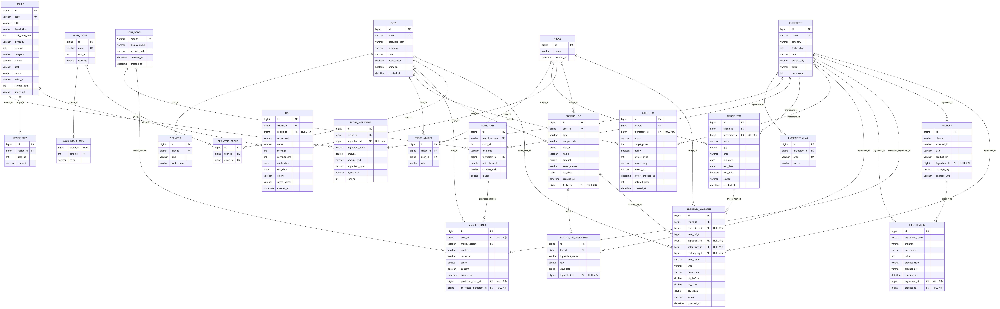

# DB 설계와 ERD (Flyway V5)

기존 19개 테이블을 확장해 현재 23개 테이블을 사용한다. V4는 무결성을, V5는 관계·재고 이력과 상품·모델 식별을 보완한다.

- [관계·이력 보완 설계서](../superpowers/specs/2026-10-28-database-relations-design.md): V5 테이블·이관·서비스 연동
- [보완 설계서](../superpowers/specs/2026-10-28-database-design.md): 업무 규칙, 제약조건, 조회 설계와 변경 근거
- [컬럼 사전](data-dictionary.md): 23개 테이블의 타입·NULL·키·기본값·설명
- [운영 안내](operations.md): MySQL 실행, 사전 점검, 백업·복구, 테스트
- [V4 사전 점검 SQL](preflight.sql) · [V5 사전 점검 SQL](preflight-v5.sql): 기존 데이터의 이관 가능 여부 조회
- [ERD Mermaid 원본](erd.mmd): V1~V5의 실제 FK 관계



이미지를 확대하면 컬럼을 읽을 수 있다. `erd_초안.*`는 기획 단계 참고 자료이다.

## 데이터 그룹

| 그룹 | 테이블 | 관리 주체 |
|---|---|---|
| 기준 | ingredient, ingredient_alias, avoid_group, avoid_group_term, recipe, recipe_ingredient, recipe_step, scan_model, scan_class, product | 팀: Flyway seed SQL |
| 사용자 | users, user_avoid, user_avoid_group, fridge, fridge_member, fridge_item, dish, cart_item | API |
| 기록 | cooking_log, cooking_log_ingredient, price_history, scan_feedback, inventory_movement | 시스템 |

## 주요 설계 결정

- 미등록 재료의 ingredient_id는 NULL을 허용하며 입력 이름을 함께 저장한다.
- 같은 재료라도 소비기한이 다르면 fridge_item에 별도 행으로 보관한다.
- fridge_member로 회원과 냉장고를 연결해 가족 공유로 확장할 수 있다.
- dish는 냉장고 단위, cooking_log는 회원 단위로 관리한다.
- 요리를 모두 먹거나 버리면 dish가 삭제된다. cooking_log.dish_id는 당시 ID 스냅샷이며 FK를 두지 않는다.
- scan_feedback.user_id는 NULL 허용 FK이다. 존재하지 않는 회원 ID는 거절하고 참조 중인 회원의 삭제는 차단한다.
- 레시피 재료 매칭은 기존 표준 이름을 사용한다. 식재료 동의어는 ingredient_alias에서 변환한다.
- user_avoid_group은 회원과 알레르기 분류를 ID로 연결하고, user_avoid에는 직접 입력한 ITEM만 저장한다.
- 데이터 변경 시 기존 V1~V4는 수정하지 않고 새 마이그레이션을 추가한다.

## V4 추가 사항

CHECK 15개, 피드백 회원 FK 1개, 복합 인덱스 3개를 추가한다.

- 수량·가격은 음수를 차단한다. 기본 수량과 만든 인분은 양수여야 한다.
- 남은 인분은 0 이상 원래 인분 이하이며, 모델 인식 기준·mAP50은 0~1이다.
- 수량·남은 인분의 0은 삭제 전 중간 상태로 허용한다.
- 과거 소비기한과 nullable 값은 기존대로 허용한다.
- 이름별 소비기한 순 차감, 최근 COOK 기록, 최신 기록 목록의 조회 조건을 지원한다.

## V5 추가 사항

- user_avoid_group: 분류 이름이 바뀌어도 회원의 선택과 추천 제외 용어 유지.
- inventory_movement: 등록·수정·요리 차감·폐기 및 기존 재고 OPENING 이력. 재고 삭제 후에도 스냅샷 보존.
- product: 채널+외부 상품 ID로 식별하고 가격 이력에 연결. 포장 수량을 제목에서 추정하지 않음.
- scan_model: 모델 버전 레지스트리와 클래스·수정 피드백 FK. 피드백의 예측 클래스·수정 재료는 확실한 경우만 연결.
- cooking_log.fridge_id, cooking_log_ingredient.ingredient_id, price_history의 재료·상품 참조 추가.
- 재고 변경 시 행 잠금, 같은 트랜잭션 내 원장 기록, 실제 반올림 후 차감량 기록.
- 과거 기록은 확인 가능한 관계만 이관하며 불명확한 값은 NULL로 보존.

## 검증 결과 (2026-10-28)

- H2 프로필 전체 74개 테스트 통과: 기존 API·seed, 새 관계·이관, 재고 동시성·롤백, 상품·모델 및 사전 점검 포함.
- MySQL 8.4: V4→V5 데이터 보존·FK·원장 이관 검증 통과. 이전 V4 전용 회귀 검증도 유지.
- 별도 빈 MySQL DB의 mysql 프로필 전체 74개 테스트 통과: V1~V5 전체 초기화, seed·API·재고 동시성·롤백 포함. 독립 JDBC 테스트는 자체 H2를 사용하는 항목도 있다.
- MySQL에서 V4/V5 사전 점검 SQL 결과 0행 확인.

수행 환경의 검증 결과이며 운영 데이터에 대한 점검·성능 측정을 대체하지 않는다.

## ERD 재생성

Mermaid CLI와 Chrome/Chromium이 있는 환경에서 프로젝트 루트 기준으로 실행한다.

```bash
npx --yes @mermaid-js/mermaid-cli@11.12.0 -i docs/erd/erd.mmd -o docs/erd/erd.png -w 2400 -s 3 -b white
```

CLI가 Chrome을 찾지 못하면 `-p`로 Puppeteer의 executablePath 설정 JSON을 지정한다.
